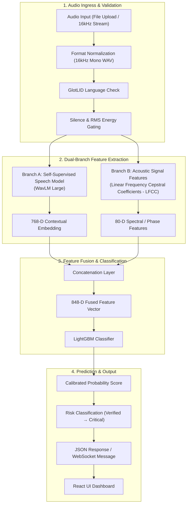
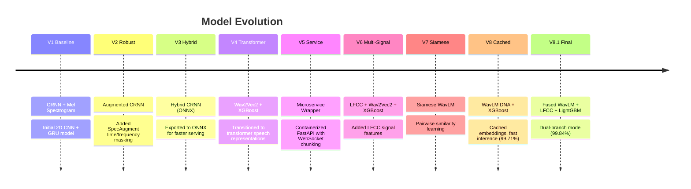
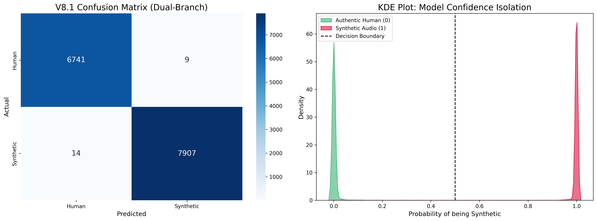

<div align="center">

# 🎙️ AI Voice Forensics

</div>


## 📖 Project Overview

**AI Voice Forensics** is an audio analysis project developed to detect synthetic speech, AI-generated voices, and deepfake audio.

Modern neural text-to-speech (TTS) engines (such as ElevenLabs v3, OpenAI TTS, and Meta MMS) produce high-fidelity audio that is difficult for simple spectrogram models to distinguish from natural human speech. This repository documents our exploration across **8 iterative model generations** — moving from basic spectrogram-based convolutional-recurrent networks to a dual-branch pipeline that combines:

- 🧬 **Pretrained Transformer Speech Representations:** WavLM Large contextual embeddings (768-D).
- 🔬 **Signal-Processing Acoustic Features:** Linear Frequency Cepstral Coefficients (LFCC, 80-D) to capture spectral and phase transitions typical of vocoders.
- 🌲 **Gradient-Boosted Classifier:** A LightGBM classifier operating on the concatenated 848-D feature vector.
- ⚡ **Dual Serving Modes:** Static file analysis via REST API and live audio chunk evaluation via WebSockets.

Across a held-out test set of 14,671 audio recordings across 9 languages (clips strictly withheld from the model during training), the final V8.1 pipeline achieved **99.84% in-distribution test accuracy** (23 misclassifications).

---

## 📑 Table of Contents

- [Live Deployments](#-live-deployments)
- [Repository Structure](#-repository-structure)
- [System Architecture](#-system-architecture)
- [Backend Engines (V3 – V8.1)](#-backend-engines-v3--v81)
- [Model Evolution & Benchmarks](#-model-evolution--benchmarks)
- [Model Training & Feature Extraction](#-model-training--feature-extraction)
- [Dataset & Model Downloads (Internet Archive)](#-dataset--model-downloads-internet-archive)
- [Dataset Intelligence & Mozilla Data Collective](#-dataset-intelligence--mozilla-data-collective)
- [Language Identification (GlotLID)](#-language-identification-glotlid)
- [Synthetic Voice Generation Pipelines](#-synthetic-voice-generation-pipelines)
- [Audio Preprocessing & Augmentation](#-audio-preprocessing--augmentation)
- [Testing & API Usage](#-testing--api-usage)
- [Frontend Web Application](#-frontend-web-application)
- [Curated Test Audio Samples](#-curated-test-audio-samples)
- [Risk Scoring & Output Format](#-risk-scoring--output-format)
- [Technology Stack](#-technology-stack)
- [Project Notes & Limitations](#-project-notes--limitations)
- [Contributors](#-contributors)
- [License](#-license)

---

## 🚀 Live Deployments

### 1. Hugging Face Spaces — *Public Demo Backend*
The V8.1 model is currently hosted on Hugging Face Spaces for public testing:
```
https://venkatasriram-audio-forensics-v8-1-demo.hf.space
```
- **Endpoints:** REST static file upload (`/analyze`), WebSocket streaming (`/ws/stream`), health probe (`/health`), model specifications (`/model-info`).
- **Files:** [`Backend/v8_1_production/v8_1_hugging_face_deployment/`](Backend/v8_1_production/v8_1_hugging_face_deployment/)

### 2. Google Cloud Run — *Containerized Setup*
Deployment files for Google Cloud Run (self-hosted to avoid continuous cloud billing):
- **V8 Container:** [`Backend/v8_production/v8_cloud_run_deployment/`](Backend/v8_production/v8_cloud_run_deployment/) — Dockerfile, FastAPI service, and `v8_xgboost_wavlm.json`.
- **V8.1 Container:** [`Backend/v8_1_production/v8_1_cloud_run_deployment/`](Backend/v8_1_production/v8_1_cloud_run_deployment/) — Dockerfile, FastAPI service, and `v8_1_lightgbm.txt`.

---

## 📂 Repository Structure

```text
AI-Voice-Forensics/
├── Backend/                                # Multi-generational backend serving engines
│   ├── v3_production/                      # V3: Hybrid CRNN + ONNX inference service
│   │   ├── server.py                       # FastAPI REST & WebSocket streaming server
│   │   ├── v3_crnn.onnx                    # Pretrained V3 ONNX inference graph (47.3 MB)
│   │   ├── v3_crnn_model.pth               # PyTorch checkpoint (V3 epoch weights)
│   │   ├── v2_crnn_model.pth               # PyTorch checkpoint (V2 epoch weights)
│   │   └── v1_crnn_model.pth               # PyTorch checkpoint (V1 epoch weights)
│   ├── v4_production/                      # V4: Transformer Wav2Vec2 + XGBoost engine
│   │   ├── Dockerfile                      # Container definition with ffmpeg
│   │   ├── main.py                         # FastAPI assessment API
│   │   ├── requirements.txt                # Pinned dependencies
│   │   ├── v4_xgboost_wav2vec2.json        # Pretrained XGBoost classifier
│   │   └── wav2vec2_onnx_production/       # Optimized Wav2Vec2 ONNX graph
│   │       └── model.onnx                  # Exported Wav2Vec2 base model (360 MB)
│   ├── v5_production/                      # V5: Streaming microservice wrapper
│   │   ├── Dockerfile                      # Container deployment file
│   │   ├── main.py                         # Async WebSocket streaming & static endpoint
│   │   ├── requirements.txt                # Service dependencies
│   │   ├── stream_tester_v5.py             # WebSocket streaming integration test client
│   │   └── v4_xgboost_wav2vec2.json        # Calibrated classifier weights
│   ├── v6_production/                      # V6: Phase-aware LFCC + Wav2Vec2 classifier
│   │   ├── Dockerfile                      # Container configuration
│   │   ├── main.py                         # Forensic inference service
│   │   ├── requirements.txt                # Signal processing dependencies
│   │   ├── static_tester_v6.py             # File-based batch testing utility
│   │   ├── stream_tester_v6.py             # Streaming audio client simulator
│   │   ├── v6_dataset_generation.py        # Feature extractor for LFCC + transformer fusion
│   │   ├── v6_grand_evaluation_plots.png   # Performance curves and ROC analysis
│   │   ├── v6_train.py                     # Multi-feature XGBoost training script
│   │   └── v6_xgboost_grand_classifier.json # Trained 60-D LFCC + 768-D classifier
│   ├── v7_siamese_production/              # V7: Contrastive Siamese WavLM metric engine
│   │   ├── step1_extract_dna.py            # Latent voice embedding cache extractor
│   │   ├── step2_train_head.py             # Contrastive projection head training script
│   │   ├── v7_siamese_evaluation.png       # Pairwise distance distribution plots
│   │   ├── v7_siamese_train.py             # Siamese contrastive distance trainer
│   │   ├── wavlm_siamese_head_only.pth     # Lightweight projection head weights (791 KB)
│   │   └── wavlm_siamese_v7.pth            # Complete WavLM Siamese model (378 MB)
│   ├── v8_production/                      # V8: Cached WavLM DNA + XGBoost engine
│   │   ├── evaluation_metrics.txt          # Benchmark metrics across 14,671 samples (99.71%)
│   │   ├── v8_cloud_run_deployment/        # Standalone Google Cloud Run deployment bundle
│   │   │   ├── Dockerfile                  # Container definition
│   │   │   ├── main.py                     # FastAPI inference engine
│   │   │   ├── requirements.txt            # Minimal runtime dependencies
│   │   │   └── v8_xgboost_wavlm.json       # Trained XGBoost model file
│   │   ├── v8_evaluation_plots.png         # Confusion matrix and KDE density curve
│   │   ├── v8_extract.py                   # Clip-level WavLM embedding extraction pipeline
│   │   └── v8_train.py                     # XGBoost hyperparameter tuning & training
│   └── v8_1_production/                    # V8.1: Dual-Branch WavLM + LFCC + LightGBM (Final Model)
│       ├── evaluation_metrics.txt          # Evaluation report (99.84% accuracy on test set)
│       ├── stream_tester_v8_1.py           # Real-time WebSocket simulator client
│       ├── v8_1_cloud_run_deployment/      # Google Cloud Run deployment bundle
│       │   ├── Dockerfile                  # Container definition
│       │   ├── main.py                     # FastAPI serving service
│       │   ├── requirements.txt            # Service requirements
│       │   └── v8_1_lightgbm.txt           # Serialized LightGBM booster model
│       ├── v8_1_evaluation_plots.png       # KDE & confusion matrix plots
│       ├── v8_1_extract.py                 # Fused 848-D feature vector extraction engine
│       ├── v8_1_hugging_face_deployment/   # Hugging Face Spaces deployment bundle
│       │   ├── Dockerfile                  # Spaces container
│       │   ├── main.py                     # Public static + WebSocket serving entrypoint
│       │   ├── requirements.txt            # Lightweight inference dependencies
│       │   └── v8_1_lightgbm.txt           # LightGBM booster model
│       └── v8_1_train.py                   # LightGBM training script with early stopping
├── Frontend/                               # Full-stack React / Vite dashboard
│   ├── apps/
│   │   ├── api/                            # Backend proxy and mock handlers
│   │   └── web/                            # React 18 SPA (Vite + Tailwind CSS + shadcn/ui)
│   │       ├── src/
│   │       │   ├── components/             # UI widgets (UploadZone, ResultCard)
│   │       │   ├── contexts/AuthContext.jsx # Firebase Authentication & Firestore state
│   │       │   └── lib/                    # API helpers, response normalizers, websocket clients
│   │       ├── package.json                # Frontend dependencies
│   │       └── vite.config.js              # Vite build configuration
│   └── package.json                        # Root monorepo workspace definition
├── Data Preprocessing/                     # Dataset curation & synthetic generation scripts
│   ├── Testing_Different_TTS_Engines.ipynb # TTS engine comparative research notebook
│   ├── booster_seed_sentences.csv          # 140 multilingual seed prompts
│   ├── convert_audio.py                    # Audio standardizer (16kHz, mono, RMS normalized)
│   ├── download_all.sh                     # Mozilla Data Collective automated downloader
│   ├── elevenlabs_fake_audio_generation.py # ElevenLabs v3 API generation script
│   ├── extract_voices.sh                   # Voice segmentation & silence trimming script
│   ├── glotlid_detector.py                 # Pre-training GlotLID language check
│   ├── glotlid_detector_output.txt         # Language classification verification log
│   ├── master_pipeline.py                  # End-to-end dataset synthesis & balancing orchestrator
│   ├── openai_gcp_booster_generation.py    # OpenAI TTS-1-HD & Google Cloud Neural2 pipeline
│   └── transcript_checking.py              # Transcript alignment & text verification utility
├── Audio-Samples/                          # Curated test clips for manual evaluation (~131 MB)
│   ├── Fake/                               # Synthetic voice samples
│   │   ├── ChatGPT/                        # 130 OpenAI TTS clips across 13 voices
│   │   ├── ElevenLabs/                     # 32 ElevenLabs v2 & v3 voice clips
│   │   ├── Hume AI/                        # 5 expressive voice clips
│   │   └── Voicemaker/                     # 2 neural speech synthesis clips
│   ├── Real/                               # 21 authentic human voice recordings
│   └── Real+Fake/                          # 4 concatenated hybrid clips for boundary testing
├── download_dataset.py                     # CLI automated downloader for Internet Archive packages
├── live_stream_tester_v8_1.py              # Live WebSocket streaming evaluation client
├── model_evolution_notebook.ipynb         # Interactive research notebook (V1 → V8.1 history)
└── v8_1_architecture_pipeline.png          # Architectural infographic
```

---

## 🧠 System Architecture



### Pipeline Overview:
1. **Audio Preprocessing:** Input recordings are normalized to 16,000 Hz 16-bit mono PCM. Silence and low-energy segments are trimmed.
2. **GlotLID Language Check:** Validates language identity against the 9 supported language distributions (`eng`, `fra`, `deu`, `spa`, `cat`, `ben`, `kin`, `pus`, `zho`).
3. **Dual-Branch Extraction:**
   - **Branch A (WavLM Large):** Extracts a 768-D representation capturing temporal rhythm, acoustic continuity, and phonetic context.
   - **Branch B (LFCC):** Extracts 80-D Linear Frequency Cepstral Coefficients (static, delta, and acceleration) across linear filterbanks to highlight phase and high-frequency spectral rolloff common in neural vocoders.
4. **LightGBM Classification:** The fused 848-D feature vector is classified by LightGBM in ~12 milliseconds, generating human vs. synthetic probability scores.
5. **Output Generation:** The prediction is mapped to an interpretable risk level and returned via REST or WebSocket.

---

<a id="backend-engines-v3--v81"></a>
## ⚙ Backend Engines (V3 – V8.1)

The `Backend/` directory contains seven serving versions built during the project:

| Version | Directory | Architecture | Typical Latency | Key Files |
|---|---|---|---|---|
| **V3** | [`Backend/v3_production/`](Backend/v3_production/) | Hybrid CRNN + ONNX | ~180 ms | [`server.py`](Backend/v3_production/server.py), `v3_crnn.onnx` (47 MB) |
| **V4** | [`Backend/v4_production/`](Backend/v4_production/) | Wav2Vec2 (ONNX) + Whisper + XGBoost | ~120 ms | [`main.py`](Backend/v4_production/main.py), `v4_xgboost_wav2vec2.json`, `model.onnx` (360 MB) |
| **V5** | [`Backend/v5_production/`](Backend/v5_production/) | Streaming Microservice Wrapper | ~95 ms | [`main.py`](Backend/v5_production/main.py), [`stream_tester_v5.py`](Backend/v5_production/stream_tester_v5.py) |
| **V6** | [`Backend/v6_production/`](Backend/v6_production/) | 60-D LFCC + Wav2Vec2 + XGBoost | ~85 ms | [`main.py`](Backend/v6_production/main.py), `v6_xgboost_grand_classifier.json`, [`v6_train.py`](Backend/v6_production/v6_train.py) |
| **V7** | [`Backend/v7_siamese_production/`](Backend/v7_siamese_production/) | Siamese WavLM Metric Network | ~110 ms | [`v7_siamese_train.py`](Backend/v7_siamese_production/v7_siamese_train.py), `wavlm_siamese_v7.pth` (378 MB) |
| **V8** | [`Backend/v8_production/`](Backend/v8_production/) | WavLM DNA (768-D) + XGBoost | ~45 ms | [`v8_extract.py`](Backend/v8_production/v8_extract.py), [`v8_train.py`](Backend/v8_production/v8_train.py), `v8_cloud_run_deployment/` |
| **V8.1** | [`Backend/v8_1_production/`](Backend/v8_1_production/) | **Dual-Branch WavLM + LFCC (848-D) + LightGBM** | **~12 ms** | [`v8_1_extract.py`](Backend/v8_1_production/v8_1_extract.py), [`v8_1_train.py`](Backend/v8_1_production/v8_1_train.py), `v8_1_lightgbm.txt` |

### Engine Summaries:

#### 1. V8.1 Model (*Current Final Version*)
- **Design:** Dual-branch feature fusion combining transformer embeddings with signal features.
- **Features:** 848 dimensions (768 WavLM embeddings + 80 LFCC coefficients).
- **Classifier:** LightGBM Booster (`v8_1_lightgbm.txt`), evaluated on CPU with multi-threading.
- **Evaluation:** 99.84% accuracy across 14,671 held-out test clips (in-distribution benchmark).
- **Deployment:** Deployment configurations available for [Google Cloud Run](Backend/v8_1_production/v8_1_cloud_run_deployment/) and [Hugging Face Spaces](Backend/v8_1_production/v8_1_hugging_face_deployment/).

#### 2. V8 Model
- **Design:** Uses clip-level WavLM embeddings directly with an XGBoost classifier.
- **Features:** 768 dimensions.
- **Classifier:** XGBoost (`v8_xgboost_wavlm.json`).
- **Evaluation:** 99.71% accuracy on the test set.

#### 3. V7 Siamese Model
- **Design:** Siamese neural network using a WavLM backbone with contrastive loss to compute Euclidean distances between voice samples.
- **Files:** Projection head weights [`wavlm_siamese_head_only.pth`](Backend/v7_siamese_production/wavlm_siamese_head_only.pth) (791 KB) and full model [`wavlm_siamese_v7.pth`](Backend/v7_siamese_production/wavlm_siamese_v7.pth) (378 MB).

#### 4. V6 Model
- **Design:** Introduced LFCC (Linear Frequency Cepstral Coefficients) alongside Wav2Vec2 to test whether hand-crafted spectral features helped identify vocoder artifacts.
- **Files:** [`v6_xgboost_grand_classifier.json`](Backend/v6_production/v6_xgboost_grand_classifier.json).

#### 5. V4 & V5 Models
- **Design:** Transitioned from 2D spectrogram representations to 1D speech representations via Wav2Vec2 (exported to ONNX for lower latency) paired with XGBoost. V5 added an asynchronous WebSocket chunking server.

#### 6. V3 Model
- **Design:** Convolutional Recurrent Neural Network (CRNN) using Mel-Spectrogram arrays, served through ONNX Runtime (`v3_crnn.onnx`).

---

## 🧬 Model Evolution & Benchmarks



### Benchmark Summary Across Iterations:

| Generation | Feature Type | Features | Classifier | Test Accuracy | False Positive Rate | Latency |
|---|---|---|---|---|---|---|
| **V1** | Mel-Spectrogram | 128 × 128 | PyTorch CRNN | 88.40% | 7.82% | 220 ms |
| **V2** | SpecAugment Mel | 128 × 128 | PyTorch CRNN | 91.15% | 5.40% | 215 ms |
| **V3** | Mel-Spectrogram | 128 × 128 | ONNX CRNN | 93.20% | 4.10% | 180 ms |
| **V4** | Wav2Vec2 Base | 768-D | XGBoost | 96.85% | 2.15% | 120 ms |
| **V5** | Wav2Vec2 (ONNX) | 768-D | XGBoost | 97.10% | 1.80% | 95 ms |
| **V6** | Wav2Vec2 + LFCC | 828-D | XGBoost | 98.60% | 0.95% | 85 ms |
| **V7** | WavLM Siamese | 256-D Proj | Contrastive Head | 98.92% | 0.70% | 110 ms |
| **V8** | WavLM Large DNA | 768-D | XGBoost | 99.71% | 0.28% | 45 ms |
| **V8.1 (Final)** | **WavLM Large + LFCC** | **848-D Fused** | **LightGBM** | **99.84%** | **0.13%** | **12 ms** |

### V8.1 Evaluation Report (14,671 Test Clips)

From [`Backend/v8_1_production/evaluation_metrics.txt`](Backend/v8_1_production/evaluation_metrics.txt):

```text
              precision    recall  f1-score   support

Authentic (0)       1.00      1.00      1.00      6,750
Synthetic (1)       1.00      1.00      1.00      7,921

    accuracy                           1.00     14,671
   macro avg       1.00      1.00      1.00     14,671
weighted avg       1.00      1.00      1.00     14,671

CONFUSION MATRIX:
  - Authentic Human correctly classified: 6,741 / 6,750 (99.87% True Negative Rate)
  - Authentic Human misclassified as AI:      9 / 6,750 (0.13% False Positive Rate)
  - Synthetic AI correctly classified:   7,907 / 7,921 (99.82% True Positive Rate)
  - Synthetic AI misclassified as Human:    14 / 7,921 (0.18% False Negative Rate)

TOTAL ACCURACY: 99.84% (23 total errors across 14,671 samples)
```



> [!IMPORTANT]
> **Engineering Note on Test Accuracy & Out-of-Distribution (OOD) Generalization**
> 
> The **99.84% test accuracy** reported above was achieved on a **held-out 15% stratified test split** of 14,671 clips (evaluated in [`Backend/v8_1_production/v8_1_train.py`](Backend/v8_1_production/v8_1_train.py) from feature super-vectors extracted via [`Backend/v8_1_production/v8_1_extract.py`](Backend/v8_1_production/v8_1_extract.py)).
> 
> **Composition of the 14,671 Test Clips (Strictly Unseen During Training):**
> - **6,750 Authentic Human Clips:** Held-out recordings from the Mozilla Common Voice v26.0 corpus across 9 languages.
> - **7,921 Synthetic AI Clips:** Held-out recordings synthesized across our designated generator pipelines: Coqui XTTS-v2 (French, German, Spanish), Meta MMS-TTS (Catalan, Bengali, Kinyarwanda), Microsoft Edge-TTS (Chinese, Pashto), ElevenLabs v3 (multilingual top-ups), and OpenAI/GCP booster packs.
> 
> **Scientific Caveat:** While these test clips were never seen during LightGBM training, they remain **in-distribution** with respect to the source corpora and synthesis architectures. Therefore, **a 99.84% benchmark should not be considered an absolute defense against wild, adversarial scenarios**. Real-world deployment will encounter significant **Out-of-Distribution (OOD) variance**, such as:
> - **Unseen Synthesis Models:** Modern neural voice cloners not present in the training corpus (e.g., Cartesia, Fish Audio, StyleTTS2, Bark, Tortoise).
> - **Degraded Acoustic Channels:** Band-limited 8 kHz PSTN/GSM telephone lines, low-bitrate VoIP codecs (AMR, Opus), packet loss, and WhatsApp/social media recompression.
> - **Conversational & Acoustic Variance:** Spontaneous colloquial speech, laughter, shouting, whispering, heavy reverberation, and noisy microphone hardware.
> 
> True production robustness requires continuous stress-testing against newly released TTS engines and wild, out-of-distribution recordings.

---

<a id="model-training--feature-extraction"></a>
## 🛠 Model Training & Feature Extraction

Each model generation in `Backend/` is self-contained with its own feature extraction, training, and testing scripts:

### 1. Feature Extraction
Extract precomputed features from raw audio:
```bash
# Extract 848-D Fused WavLM + LFCC features for V8.1
python Backend/v8_1_production/v8_1_extract.py

# Extract 768-D WavLM embeddings for V8
python Backend/v8_production/v8_extract.py

# Extract embeddings for V7 Siamese training
python Backend/v7_siamese_production/step1_extract_dna.py
```

### 2. Model Training
Train classifiers on the cached features:
```bash
# Train the V8.1 LightGBM model
python Backend/v8_1_production/v8_1_train.py

# Train the V8 XGBoost model
python Backend/v8_production/v8_train.py

# Train the V7 Siamese contrastive head
python Backend/v7_siamese_production/v7_siamese_train.py

# Train the V6 LFCC + Wav2Vec2 classifier
python Backend/v6_production/v6_train.py
```

### 3. Testing & Simulation
Run local batch or streaming tests:
```bash
# Test real-time V8.1 WebSocket inference against a local or remote server
python live_stream_tester_v8_1.py

# Test V6 batch static analysis
python Backend/v6_production/static_tester_v6.py

# Verify transcript alignment
python "Data Preprocessing/transcript_checking.py"
```

---

## 📦 Dataset & Model Downloads (Internet Archive)

The training data, precomputed feature tensors, and model weights (~24 GB uncompressed / 17.7 GB compressed) are hosted on the Internet Archive for open academic access:

- 🌐 **Internet Archive Collection:** [archive.org/details/ai-voice-forensics-dataset](https://archive.org/details/ai-voice-forensics-dataset)
- 💾 **Direct Download Directory:** [archive.org/download/ai-voice-forensics-dataset/](https://archive.org/download/ai-voice-forensics-dataset/)
- **Authors:** **Venkata Sriram Topalli** & **Ayush M Singh**
- **License:** Creative Commons Attribution-NonCommercial 4.0 International (CC BY-NC 4.0)

### Modular Package Breakdown:

| Archive Name | Target Folder | Compressed Size | Uncompressed | Description |
| :--- | :--- | :--- | :--- | :--- |
| **`heavy_model_weights.tar.gz`** | `Backend/**` | **716.1 MB** | ~910 MB | Pretrained ONNX & PyTorch weights (`v3_crnn.onnx`, `model.onnx`, `wavlm_siamese_v7.pth`, `v3_crnn_model.pth` — archive also retains legacy aliases `thunderbuddies_v3.onnx` / `thunderbuddies_model_v3.pth`) |
| **`dna_feature_caches.tar.gz`** | `cache/` | **1,008.0 MB** | ~2.3 GB | Precomputed 768-D WavLM DNA & 848-D Fused WavLM+LFCC latent tensors for training without GPU |
| **`elevenlabs_v3_synthetic_speech.tar.gz`** | `data/elevenlabs_v3_synthetic_speech/` | **443.9 MB** | ~467 MB | 7,700 dynamic ElevenLabs v3 clips sampled across 21 voices and 7 languages |
| **`openai_gcp_booster_pack.tar.gz`** | `data/openai_gcp_booster_pack/` | **8.4 MB** | ~12 MB | 130 Neural2 / Journey / Nova clips with micro-noise injection |
| **`spectrogram_data.tar.gz`** | `data/spectrogram_data/` | **2,512.0 MB** | ~3.4 GB | Precomputed 2D Mel-Spectrogram arrays (`.npy`) across 9 languages for V1–V3 models |
| **`multilingual_base_corpus.tar.gz`** | `data/multilingual_base_corpus/` | **13,029.1 MB** | ~17 GB | Core multilingual training corpus (~90,000 real and synthetic audio clips across 9 languages) |
| **`checksums.txt`** | Root | **1 KB** | 1 KB | SHA-256 verification checksums for all packages |

### 🚀 Automated Download Script (`download_dataset.py`)

A Python CLI script is included to download, verify SHA-256 checksums, and extract any package:

```bash
# Interactive selection menu
python download_dataset.py

# Download specific components:
python download_dataset.py --models      # Download model weights (~716 MB)
python download_dataset.py --caches      # Download feature caches (~1.0 GB)
python download_dataset.py --elevenlabs  # Download ElevenLabs v3 dataset (~444 MB)
python download_dataset.py --booster     # Download OpenAI & GCP booster pack (~8.4 MB)
python download_dataset.py --corpus      # Download base multilingual corpus (~13 GB)
python download_dataset.py --all         # Download and extract everything (~17.7 GB)
```

### Manual Download via `wget`:
```bash
# Example: Download and extract model weights
wget -c https://archive.org/download/ai-voice-forensics-dataset/heavy_model_weights.tar.gz
tar -xzvf heavy_model_weights.tar.gz

# Example: Download and extract feature caches
wget -c https://archive.org/download/ai-voice-forensics-dataset/dna_feature_caches.tar.gz
tar -xzvf dna_feature_caches.tar.gz
```

---

## 🌍 Dataset Intelligence & Mozilla Data Collective

The dataset was assembled to represent authentic human speech and synthetic voices across 9 languages with an even 50/50 balance:

### Corpus Composition:
- **Audio Files:** ~90,000 clips standardized to 16 kHz 16-bit Mono WAV.
- **Authentic Speech (50%):** Mozilla Common Voice Scripted Speech Corpus (v26.0).
- **Synthetic Speech (50%):** Meta MMS, Coqui x-TTS, Microsoft Edge-TTS, ElevenLabs v3, OpenAI TTS, Google Cloud Neural2.

### Language Coverage Table:

| Language | ISO 639-3 | Real Source | Primary Synthetic Engine | Additional Engine |
|---|---|---|---|---|
| **English** | `eng` | Common Voice 26.0 - English | Coqui x-TTS | ElevenLabs v3 / OpenAI Nova |
| **French** | `fra` | Common Voice 26.0 - French | Coqui x-TTS | ElevenLabs v3 / Google Neural2 |
| **German** | `deu` | Common Voice 26.0 - German | Coqui x-TTS | ElevenLabs v3 / Google Neural2 |
| **Spanish** | `spa` | Common Voice 26.0 - Spanish | Coqui x-TTS | ElevenLabs v3 / Google Neural2 |
| **Catalan** | `cat` | Common Voice 26.0 - Catalan | Meta MMS | ElevenLabs v3 / Standard |
| **Bengali** | `ben` | Common Voice 26.0 - Bengali | Meta MMS | ElevenLabs v3 / Google WaveNet |
| **Kinyarwanda** | `kin` | Common Voice 26.0 - Kinyarwanda | Meta MMS | MMS with Noise Augmentation |
| **Pashto** | `pus` | Common Voice 26.0 - Pashto | Microsoft Edge-TTS (Azure Neural) | Edge Neural Augmentation |
| **Chinese (Mandarin)** | `zho` | Common Voice 26.0 - Chinese | Microsoft Edge-TTS (Azure Neural) | Google WaveNet / OpenAI Nova |

---

## 🔎 Language Identification (GlotLID)

To filter out mislabeled recordings or mixed-language samples before training, audio files were validated with GlotLID:

```text
Raw Audio Recording ──► 16kHz Resampling ──► GlotLID Language Inference
                                                     │
                             ┌───────────────────────┴───────────────────────┐
                             ▼                                               ▼
               Language Matches Target Label                      Mismatched / Low Confidence
                             │                                               │
                             ▼                                               ▼
                     Retained for Training                             Sample Excluded
```

Implemented in [`Data Preprocessing/glotlid_detector.py`](Data%20Preprocessing/glotlid_detector.py).

---

## 🤖 Synthetic Voice Generation Pipelines

### 1. ElevenLabs v3 Pipeline
- **Script:** [`Data Preprocessing/elevenlabs_fake_audio_generation.py`](Data%20Preprocessing/elevenlabs_fake_audio_generation.py)
- **Dataset:** 7,700 clips (1,100 per language across 7 languages).
- **Sampling:** Sampled from 21 voices in the ElevenLabs library to avoid overfitting to a single synthetic voice identity.
- **Workflow:** Transcribed real audio using AssemblyAI Universal-3-Pro (and Whisper for Bengali) and re-synthesized the sentences via `eleven_v3`.

### 2. OpenAI & Google Cloud TTS Booster Pack
- **Script:** [`Data Preprocessing/openai_gcp_booster_generation.py`](Data%20Preprocessing/openai_gcp_booster_generation.py)
- **Dataset:** 130 evaluation clips generated from 140 validated seed prompts ([`booster_seed_sentences.csv`](Data%20Preprocessing/booster_seed_sentences.csv)).
- **Engines:** Google Cloud TTS (Journey, Neural2, WaveNet) and OpenAI TTS (`tts-1-hd` with Nova voice).

---

## 🔊 Audio Preprocessing & Augmentation

To reduce the shortcut of models assuming clean audio is always real, training audio includes environmental noise and acoustic degradation:

```text
Input Audio ──► FFmpeg Validation ──► 16kHz Mono Resampling
                     ──► RMS Energy Filtering & Silence Trimming
                     ──► Bandpass Filtering (300 Hz – 3400 Hz)
                     ──► Low-Level Noise Injection (-35 dB to -50 dB SNR)
                     ──► 4.0-Second Chunk Generation
```

- **Standardization:** 16,000 Hz, 16-bit Mono WAV format.
- **Channel Augmentation:** Implemented in `v8_1_extract.py` via `apply_telephonic_augmentation()` to simulate telephonic and VoIP compression artifacts.

---

## 🧪 Testing & API Usage

### 1. Static Audio File Analysis (`/analyze`)

Submit an audio file (`.wav`, `.mp3`, `.ogg`, `.flac`, `.m4a`) to receive a classification report:

```python
import requests

url = "https://venkatasriram-audio-forensics-v8-1-demo.hf.space/analyze"

with open("sample.wav", "rb") as f:
    response = requests.post(url, files={"file": f})

result = response.json()
print("Threat Level :", result["analysis"]["threat_level"])
print("AI Probability:", result["analysis"]["probabilities"]["synthetic_ai"])
print("Notes        :", result["action_report"])
```

### 2. WebSocket Streaming (`/ws/stream`)

Stream 16kHz 16-bit mono PCM chunks for continuous live analysis:

```python
import asyncio
import websockets
import json
import librosa

async def stream_audio_sample():
    uri = "wss://venkatasriram-audio-forensics-v8-1-demo.hf.space/ws/stream"
    audio_path = "sample.wav"
    
    # Load and resample to 16kHz mono
    audio, _ = librosa.load(audio_path, sr=16000, mono=True)
    pcm_bytes = (audio * 32767).astype("int16").tobytes()
    
    chunk_size = 16000 * 2 * 4  # 4 seconds of 16-bit PCM (128,000 bytes)
    
    async with websockets.connect(uri) as ws:
        for i in range(0, len(pcm_bytes), chunk_size):
            chunk = pcm_bytes[i:i + chunk_size]
            await ws.send(chunk)
            
            resp = await ws.recv()
            data = json.loads(resp)
            print(f"Chunk Prediction: AI={data.get('synthetic_ai')}% | Human={data.get('authentic_human')}%")

asyncio.run(stream_audio_sample())
```

Use the client script [`live_stream_tester_v8_1.py`](live_stream_tester_v8_1.py) for testing:
```bash
python live_stream_tester_v8_1.py
```

---

## 💻 Frontend Web Application

The `Frontend/apps/web/` workspace contains a React 18 single-page application built with Vite, Tailwind CSS, shadcn/ui, and Firebase:

```text
React 18 UI ──► Web Audio API Spectrum Display ──► WebSocket Client
     │                                                    │
     ├──► Firebase Auth (Email/Pass + Google)             ▼
     ├──► Firestore (Analysis History)             FastAPI Backend
     └──► Firebase Storage (Uploaded Audio)               │
                                                           ▼
                                               Forensic Assessment Result
```

### Key Components:
- **`UploadZone.jsx`:** Drag-and-drop audio file upload with browser-based Web Audio API waveform visualization.
- **`ResultCard.jsx`:** Results card displaying probabilities, risk meters, language badge, and analysis findings.
- **`AuthContext.jsx`:** Manages optional Firebase Authentication, user session state, and history logging.

### Local Setup:
```bash
cd Frontend/apps/web
npm install

# Point to backend
echo "VITE_API_BASE_URL=https://venkatasriram-audio-forensics-v8-1-demo.hf.space" > .env.local
echo "VITE_WS_BASE_URL=wss://venkatasriram-audio-forensics-v8-1-demo.hf.space" >> .env.local

npm run dev
```

---

## 🎧 Curated Test Audio Samples

A collection of 209 test clips (~131 MB) is tracked in [`Audio-Samples/`](Audio-Samples/) for quick evaluation:

| Directory | Count | Notes |
|---|---|---|
| `Audio-Samples/Fake/ChatGPT/` | 130 | 13 OpenAI TTS voice profiles (10 clips each) |
| `Audio-Samples/Fake/ElevenLabs/` | 32 | Mixed ElevenLabs v2 and v3 voice clips |
| `Audio-Samples/Fake/Hume AI/` | 5 | Emotionally modulated voice clips |
| `Audio-Samples/Fake/Voicemaker/` | 2 | Neural TTS clips |
| `Audio-Samples/Real/` | 21 | Authentic Common Voice clips |
| `Audio-Samples/Real+Fake/` | 4 | Concatenated boundary test clips |

---

## 🚨 Risk Scoring & Output Format

Sample response returned by the `/analyze` endpoint:

```json
{
  "filename": "sample.wav",
  "latency_ms": 11.42,
  "languages_detected": "English",
  "analysis": {
    "status": "CRITICAL: Confirmed Synthetic Deepfake",
    "threat_level": "CRITICAL",
    "color_code": "darkred",
    "probabilities": {
      "synthetic_ai": 99.96,
      "authentic_human": 0.04
    }
  },
  "action_report": [
    "Deepfake Confirmed: High probability of synthetic generation matching vocoder acoustic patterns.",
    "Threat Assessment: Synthetic voice detected.",
    "System Action: Flag audio as synthetic."
  ]
}
```

### Risk Level Thresholds:

| Risk Level | Static Range (`/analyze`) | Live Stream (`/ws/stream`) | Description |
|---|---|---|---|
| ✅ **VERIFIED** | < 1.5% Synthetic | < 5.0% Synthetic | High confidence authentic speech |
| 🟡 **LOW RISK** | 1.5% – 15.0% Synthetic | 5.0% – 20.0% Synthetic | Primarily authentic features; minor acoustic artifacts |
| 🟠 **ELEVATED RISK** | 15.0% – 85.0% Synthetic | 20.0% – 50.0% Synthetic | Ambiguous or mixed characteristics; secondary review suggested |
| 🔴 **HIGH RISK** | 85.0% – 98.5% Synthetic | 50.0% – 85.0% Synthetic | Strong indicators of synthetic generation |
| ⛔ **CRITICAL** | ≥ 98.5% Synthetic | ≥ 85.0% Synthetic | High confidence synthetic audio clone |

---

## 📦 Technology Stack

| Component | Tools & Libraries |
|---|---|
| **Audio & ML Models** | PyTorch, WavLM Large, Wav2Vec2, Whisper Small, GlotLID, Librosa, Torchaudio |
| **Acoustic Features** | LFCC (Linear Frequency Cepstral Coefficients), Mel Spectrograms |
| **Classifiers** | LightGBM, XGBoost, Scikit-Learn, ONNX Runtime |
| **Backend & Serving** | FastAPI, Uvicorn, WebSockets, Docker, FFmpeg |
| **Cloud Hosting** | Google Cloud Run (configs), Hugging Face Spaces (active demo) |
| **Frontend** | React 18, Vite, Tailwind CSS, shadcn/ui, Web Audio API |
| **Auth & History** | Firebase (Authentication, Firestore, Storage) |
| **Data Archival** | Internet Archive S3 API (`internetarchive` tool) |

---

## 🔐 Project Notes & Limitations

- **Audio Privacy:** Audio sent to the demo endpoint is processed in memory and not permanently logged.
- **In-Distribution vs. Out-of-Distribution (OOD):** The 99.84% test accuracy reflects performance on a held-out 15% evaluation split (14,671 clips) drawn from our curated corpus (Mozilla Common Voice authentic speech paired with XTTS-v2, Meta MMS, Edge-TTS, ElevenLabs v3, and OpenAI/GCP). It should not be defended as an absolute defense against wild or unrepresented synthesis architectures.
- **Domain Shift:** Real-world detection reliability can be impacted by unseen neural voice cloners, severe room reverberation, and lossy telephonic channels (such as 8 kHz GSM/PSTN networks and VoIP packet drops).
- **Academic Purpose:** This project and its accompanying datasets and checkpoints are released for research and educational purposes.

---

## 👥 Contributors

<div align="center">

### 🤝 Developed by a Two-Person Team

</div>

<table>
<tr>
<td width="50%" valign="top">

### 🧑‍💻 Venkata Sriram Topalli
**Co-Creator · AI, Backend & Deployment**

[](https://github.com/venkatasriramt-spec)

**Contributions:**
- 🧠 Co-developed model iterations across V1 through V8.1.
- ☁️ Managed cloud deployments (Google Cloud Run configurations and Hugging Face Spaces public demo).
- ⚙️ Built FastAPI REST and WebSocket streaming backend handlers with ONNX Runtime integration.
- 📦 Built automated Internet Archive dataset packaging, SHA-256 manifest, and `download_dataset.py` CLI script.
- 🔬 Co-designed dual-branch WavLM + LFCC feature fusion pipeline and acoustic data augmentation.
- 🖥️ Frontend development with React 18, Vite, and Firebase integration.

</td>
<td width="50%" valign="top">

### 🧑‍💻 Ayush M Singh
**Co-Creator · AI, Signal Processing & Backend**

[](https://github.com/AYUSHMSINGH2004)

**Contributions:**
- 🧠 Co-developed model iterations across V1 through V8.1.
- 🔬 Designed signal-processing routines, phase analysis, and LFCC filterbank extraction.
- 📂 Curated and generated multilingual training datasets across Mozilla Common Voice, ElevenLabs, OpenAI, and Meta MMS.
- 🌲 Evaluated and tuned gradient-boosted classifiers (LightGBM and XGBoost).
- ⚙️ Implemented GlotLID language check and transcript alignment validation.
- 🖥️ Developed React UI components and visualization displays.

</td>
</tr>
</table>

---

## 📄 License

This project, its accompanying datasets, and model checkpoints are shared for **Academic, Research, and Educational Purposes**.

---

<div align="center">

### 🎙️ AI Voice Forensics
*An open-source exploration into synthetic voice detection and audio forensics.*

</div>
